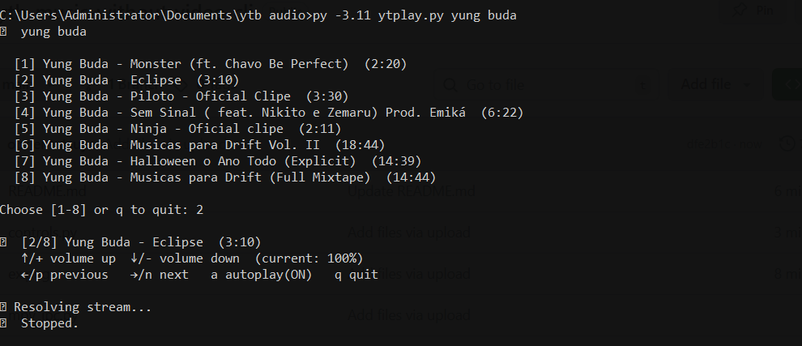

> **Legacy Python implementation.** The current single-binary version is documented in [README.md](README.md).

# ytb-music-without-video-cli

High-performance YouTube audio streamer for the terminal. Search, pick, and
stream music directly from YouTube with no downloads, no video and no GPU.

---

---

## Features

- Search YouTube from the terminal and pick a result.
- Paste a **single video**, **playlist**, or **radio mix** URL.
- Queue navigation, autoplay toggle and shuffle.
- Live volume, pause and seek controls through mpv's IPC socket.
- Audio-only playback: no video decoding, no downloads.
- Automatic `ffplay` fallback when mpv is not installed (playback only).

---

## Requirements

| Tool | Required | Purpose |
|---|---|---|
| Python 3.10+ | yes | run the player |
| yt-dlp | yes | search and resolve audio streams |
| mpv | recommended | playback, live volume/pause/seek |
| ffmpeg / ffplay | alternative | basic playback without mpv |

---

## Installation

### Recommended: install as a command

```bash
git clone https://github.com/obrientatsuya/ytb-music-without-video-cli.git
cd ytb-music-without-video-cli
python -m venv .venv
source .venv/bin/activate        # Windows: .venv\Scripts\activate
pip install .
ytplay --version
```

This installs `yt-dlp` and creates the `ytplay` command. You can also run the
script directly without installing the package:

```bash
pip install -r requirements.txt
python ytplay.py "song name"
```

### Windows

1. Install **Python 3.11+** from https://www.python.org/downloads/ and check
   **"Add python.exe to PATH"**.
2. Install yt-dlp:

```cmd
py -3.11 -m pip install yt-dlp
```

3. Install mpv:

```cmd
winget install shinchiro.mpv
```

Or download the Windows build from https://mpv.io/installation/, extract it and
add the folder containing `mpv.exe` to `PATH`.

### Linux

```bash
# Arch / CachyOS
sudo pacman -S python mpv

# Ubuntu / Debian
sudo apt install python3 mpv

# yt-dlp (all distros)
pip install yt-dlp
```

`ffmpeg`/`ffplay` can replace mpv for basic playback:

```bash
sudo pacman -S ffmpeg     # Arch
sudo apt install ffmpeg   # Ubuntu / Debian
```

### macOS

```bash
brew install python mpv yt-dlp
```

---

## Usage

```bash
# Search by name
ytplay "daft punk instant crush"

# Direct video URL
ytplay "https://www.youtube.com/watch?v=VIDEO_ID"
ytplay "https://youtu.be/VIDEO_ID"

# Full playlist or radio mix (quote URLs on Windows!)
ytplay "https://www.youtube.com/playlist?list=PLxxxx"
ytplay "https://www.youtube.com/watch?v=xxxx&list=RDGMEMxxxx"

# A URL that contains both a video and a playlist: play only the video
ytplay --single "https://www.youtube.com/watch?v=xxxx&list=PLxxxx"

# No arguments: interactive prompt
ytplay
```

You can run the script form instead of the installed command:

```bash
python ytplay.py "daft punk instant crush"
```

### Options

```bash
ytplay --help
```

| Option | Description |
|---|---|
| `-n`, `--limit N` | Number of search results, 1-50 (default: 8) |
| `--playlist-limit N` | Maximum playlist tracks to load (default: 500) |
| `--no-autoplay` | Stop after the current track |
| `--shuffle` | Shuffle the queue, keeping the chosen track first |
| `--volume 0-130` | Initial volume (default: 100) |
| `--single` | Ignore the playlist part of a URL and play only its video |
| `-V`, `--version` | Show the version |

> Always wrap URLs in quotes on Windows. The `&` character breaks the command
> otherwise.

---

## Playback Controls

| Key | Action |
|---|---|
| `↑` or `+` / `=` | Volume up (+5%) |
| `↓` or `-` / `_` | Volume down (-5%) |
| `space` | Pause / resume (mpv) |
| `.` or `>` | Seek forward 5s (mpv) |
| `,` or `<` | Seek back 5s (mpv) |
| `→` or `n` | Next track |
| `←` or `p` | Previous track |
| `a` | Toggle autoplay |
| `q` or `Ctrl+C` | Stop |

Live volume, pause and seek use mpv's IPC socket. With the `ffplay` fallback,
these three controls are unavailable, but queue navigation, autoplay and
keyboard input still work.

---

## Audio Quality

| Format | Quality | Notes |
|---|---|---|
| opus (default) | ~128kbps | Perceptually equivalent to MP3 320k |
| aac | ~128kbps | Automatic fallback |

ytplay always asks yt-dlp for the best audio-only stream. No video is ever
downloaded or decoded.

---

## File Structure

```
ytplay.py              entry point / source-run wrapper
ytplay_cli/
  __main__.py          python -m ytplay_cli
  cli.py               argument parsing and main flow
  search.py            search, URL detection, yt-dlp resolution
  player.py            playback, queue, volume, pause and seek
  playqueue.py         queue state management
  controls.py          background keyboard listener
  mpv_ipc.py           real-time mpv IPC socket
  ui.py                result picker and playlist viewer
tests/
  test_core.py         URL, parsing, queue and CLI tests
```

---

## Troubleshooting

**`yt-dlp not found` or `No module named yt_dlp`**

```bash
pip install yt-dlp
# or, if you use pipx:
pipx install yt-dlp
```

**`mpv not found`**

Install mpv or make sure `mpv.exe` / `mpv` is in `PATH`. If mpv is missing,
ytplay falls back to `ffplay`; live volume/pause/seek will be disabled.

**`python not recognized`**

Reinstall Python and check "Add to PATH", or use `py -3.11` instead of
`python`.

**Playlist only loads 8 tracks**

Wrap the URL in quotes so the shell does not cut it at `&`:

```bash
ytplay "https://youtube.com/watch?v=xxx&list=xxx"
```

**Volume, pause or seek does nothing**

Those controls require mpv. Check that `mpv --version` works and that you are
not using the `ffplay` fallback. Errors from the mpv IPC socket are reported
when playback starts.

**Terminal is left without echo after `kill -9`**

A hard kill cannot run cleanup handlers. Restore the terminal with:

```bash
stty sane
```

**Two songs playing at the same time**

Normal exits (including `q`, `Ctrl+C` and `SIGTERM`) stop mpv automatically. If
a previous session was killed with `kill -9`, close it manually:

```bash
pkill mpv
```
