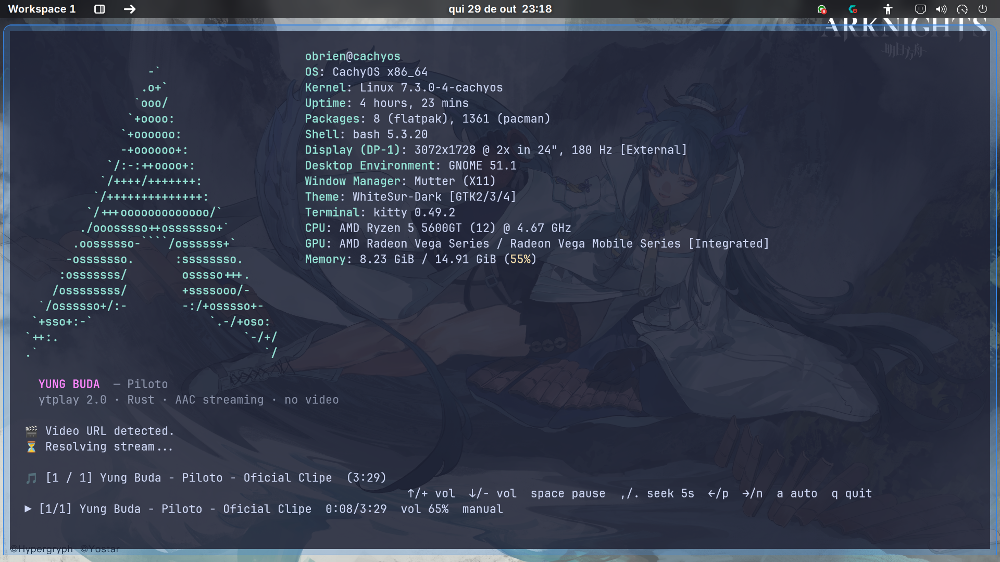

# ytplay

A **single-binary** YouTube audio streamer for the terminal. No Python, no
mpv, no browser, no video decoding. Linux and Windows.

The Rust version lives in [`rust/`](rust/). It embeds `yt-dlp` inside the
executable and plays AAC audio in-process with [rodio](https://github.com/RustAudio/rodio).





## Why this version

| | Python + mpv (old) | Rust single binary |
|---|---|---|
| Python process | ~15–17 MB | none |
| mpv process | ~69 MB | none |
| Audio playback | external mpv | in-process |
| Steady playback RAM | ~86 MB | **~5.9 MB** measured |
| CPU while playing | ~1–3% | **~0.4%** measured |
| Distribution | Python + mpv + yt-dlp | **one executable** |
| Binary size | Python + dependencies | **44 MB Linux / 27 MB Windows** |

The transient peak is still ~80–90 MB because `yt-dlp` extracts YouTube
metadata. That process exits after resolving the stream, and playback drops
back to single-digit MB. The Rust side uses `--print` instead of full JSON,
`ureq` instead of an async HTTP stack, a 32 KB read buffer, no JS runtime, no
Python and no mpv process.

## Download and run

Download the latest binaries from the [release page](https://github.com/obrientatsuya/ytb-music-without-video-cli/releases/latest):

- **Windows:** [`ytplay-windows-x86_64.exe`](https://github.com/obrientatsuya/ytb-music-without-video-cli/releases/latest/download/ytplay-windows-x86_64.exe).
  Double-click it. A console window opens.
- **Linux:** [`ytplay-linux-x86_64`](https://github.com/obrientatsuya/ytb-music-without-video-cli/releases/latest/download/ytplay-linux-x86_64).
  Make it executable once and double-click or run it:

```bash
chmod +x ytplay-linux-x86_64
./ytplay-linux-x86_64
```

Release binaries are built by [`.github/workflows/build.yml`](.github/workflows/build.yml).

On Linux, if the binary is launched without a terminal (double-click from a
file manager), it detects that and opens one of the installed terminal
emulators automatically. If your file manager does not execute binaries, use
the **Run** / **Allow executing** option once, or create a `.desktop` file:

```ini
[Desktop Entry]
Type=Application
Name=ytplay
Exec=/home/YOUR_USER/bin/ytplay
Terminal=true
```

## Build from source

Requirements: Rust 1.85+ and a C toolchain. Linux also needs ALSA headers.

```bash
cd rust
./scripts/fetch-yt-dlp.sh linux      # Windows: .\scripts\fetch-yt-dlp.ps1
cargo build --release
./target/release/ytplay
```

The build embeds `yt-dlp` into the binary, so the result is a single file:

```bash
rust/target/release/ytplay          # Linux
rust\target\release\ytplay.exe      # Windows
```

## Usage

```bash
# Search
ytplay "yung buda"

# One-letter flags
ytplay -n 3 "yung buda"                 # 3 search results
ytplay -N -v 65 https://youtu.be/ID     # no autoplay, volume 65
ytplay -s -p 100 PLAYLIST_URL           # shuffle, max 100 tracks
ytplay -S "https://www.youtube.com/watch?v=ID&list=LIST"  # single video

# No arguments: interactive prompt
ytplay
```

| Short | Long | Meaning |
|---|---|---|
| `-n N` | `--limit N` | search results, 1–50 |
| `-p N` | `--playlist-limit N` | playlist tracks, up to 5000 |
| `-N` | `--no-autoplay` | stop after current track |
| `-s` | `--shuffle` | shuffle queue |
| `-v N` | `--volume N` | volume 0–130 |
| `-S` | `--single` | play only the video from a playlist URL |
| `-V` | `--version` | version |
| `-h` | `--help` | help |

The short flags are the recommended/minimal form; long flags remain for
compatibility.

### Controls

| Key | Action |
|---|---|
| `↑` or `+` / `=` | Volume up |
| `↓` or `-` / `_` | Volume down |
| `space` | Pause / resume |
| `.` or `>` | Seek forward 5s |
| `,` or `<` | Seek back 5s |
| `→` or `n` | Next track |
| `←` or `p` | Previous track |
| `a` | Toggle autoplay |
| `q`, `Esc` or `Ctrl+C` | Stop |

## How it works

1. The binary embeds a standalone `yt-dlp` and extracts it to the user cache
   on first run.
2. Search/playlists use lightweight `yt-dlp --print` fields, not full JSON.
3. For playback it asks `yt-dlp` for an AAC stream using the
   `android_music`/`ios_music`/`mediaconnect` clients, which do not require a
   JavaScript runtime.
4. Audio is streamed over HTTP with `Range` support and decoded by
   Symphonia/rodio. No video stream is downloaded or decoded.
5. If a stream URL is rejected, it falls back to a temporary AAC download
   that is deleted when the track ends.

## One-file caveats

- The binary is ~44 MB on Linux and ~27 MB on Windows because `yt-dlp` is embedded.
- On Linux it dynamically links `libasound.so.2` (standard on desktop distros).
- The embedded `yt-dlp` is a snapshot. Rebuild the binary to update it.
- Some unusual videos may require cookies or a PO token; those are outside the
  current scope.
- The legacy Python implementation is documented in [`PYTHON.md`](PYTHON.md).
